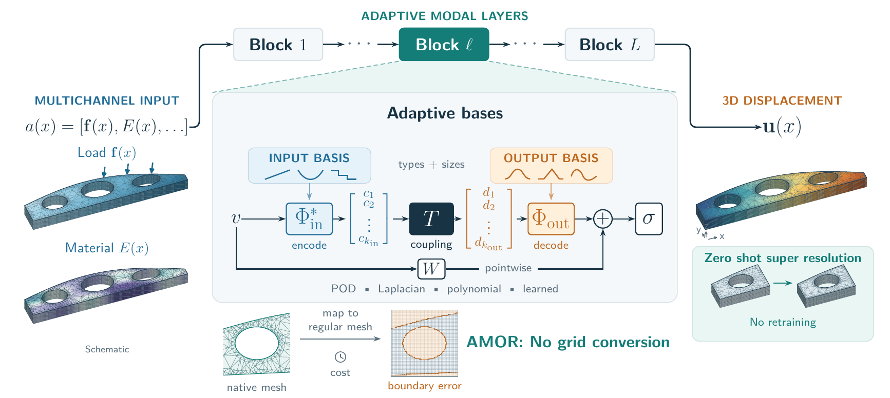
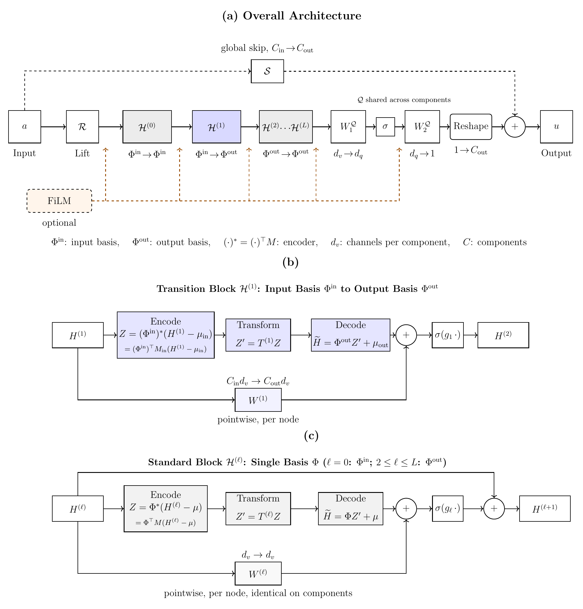
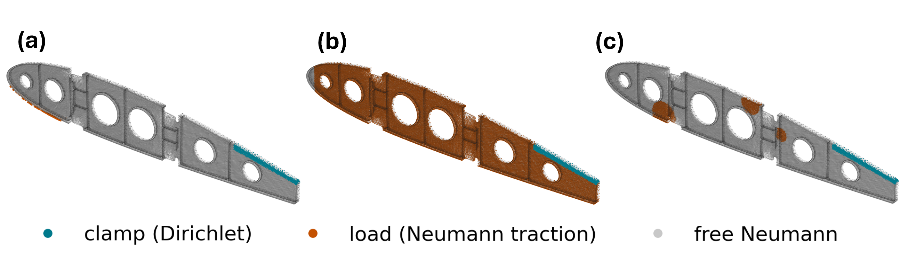

# Adaptive Modal Operator Refinement (AMOR)

[](https://arxiv.org/abs/2610.37485)
[](https://doi.org/10.5281/zenodo.18815516)

Code for the paper [*AMOR: Adaptive Modal Operator Refinement for Operator Learning on Arbitrary Meshes and Irregular 3D Geometries*](https://arxiv.org/abs/2610.37485) (Voderholzer, Vetter, O'Leary-Roseberry): train AMOR / FNO / PCANet, regenerate the paper datasets, and apply the same AMOR class to a new grid or mesh problem.

**Dataset binaries are not in this repository.** AMOR-generated datasets are on Zenodo ([10.5281/zenodo.18815516](https://doi.org/10.5281/zenodo.18815516)). Third-party sets (Kolmogorov, FlowBench) are linked under Citation.

There is **one** AMOR implementation: `AMOR.models.amor.AMOR`. Mass weighting, FiLM, coordinates, 2D/3D layout, and trainable QR/Cayley bases are constructor options.

<p align="center">
  
</p>
<p align="center"><em>Graphical abstract.</em></p>

<p align="center">
  
</p>
<p align="center"><em>AMOR architecture (Figure 1 of the paper): lifting, hidden reduced-basis layers with the transition from the input to the output basis, shared projection, optional global skip and FiLM conditioning.</em></p>

## Results from the paper

Numbers as reported in the paper ([arXiv:2610.37485](https://arxiv.org/abs/2610.37485)).

Relative test errors in percent. AMOR, FNO, and PCANet on the structured two-dimensional benchmarks (Table 3 of the paper; mean ± standard deviation over five seeds; best mean in bold):

| Dataset | Model | Rel. L¹ [%] | Rel. L² [%] |
|---|---|---|---|
| Nonlinear diffusion (ℓm, ℓf) = (0.5, 0.4) | AMOR | **0.50 ± 0.02** | **0.54 ± 0.02** |
| | FNO | 1.75 ± 0.10 | 1.73 ± 0.10 |
| | PCANet | 14.26 ± 0.54 | 14.36 ± 0.52 |
| Nonlinear diffusion (ℓm, ℓf) = (0.3, 0.2) | AMOR | **1.97 ± 0.09** | **2.07 ± 0.09** |
| | FNO | 4.27 ± 0.44 | 4.15 ± 0.42 |
| | PCANet | 31.35 ± 0.76 | 31.90 ± 0.79 |
| Nonlinear diffusion (ℓm, ℓf) = (0.15, 0.1) | AMOR | **10.87 ± 0.39** | **10.97 ± 0.37** |
| | FNO | 12.03 ± 0.85 | 11.16 ± 0.77 |
| | PCANet | 57.05 ± 0.64 | 60.42 ± 0.96 |
| Helmholtz (σ, ρ) = (0.1, 0.6) | AMOR | **1.70 ± 0.02** | **1.70 ± 0.02** |
| | FNO | 4.47 ± 0.07 | 5.09 ± 0.07 |
| | PCANet | 3.24 ± 0.05 | 3.25 ± 0.05 |
| Helmholtz (σ, ρ) = (0.2, 0.4) | AMOR | **5.18 ± 0.05** | **5.12 ± 0.04** |
| | FNO | 10.61 ± 0.43 | 11.35 ± 0.38 |
| | PCANet | 8.46 ± 0.12 | 8.43 ± 0.12 |
| Helmholtz (σ, ρ) = (0.4, 0.2) | AMOR | **18.71 ± 0.13** | **18.45 ± 0.12** |
| | FNO | 27.12 ± 1.39 | 27.87 ± 1.54 |
| | PCANet | 26.03 ± 0.48 | 25.91 ± 0.46 |
| Kolmogorov flow, Re = 40 | AMOR | 7.88 ± 0.19 | 7.96 ± 0.20 |
| | FNO | **3.48 ± 0.04** | **3.54 ± 0.04** |
| | PCANet | 35.06 ± 0.07 | 37.81 ± 0.03 |
| Kolmogorov flow, Re = 500 | AMOR | 36.59 ± 0.34 | 32.60 ± 0.33 |
| | FNO | **28.90 ± 0.20** | **26.07 ± 0.17** |
| | PCANet | 89.29 ± 0.86 | 86.28 ± 1.72 |
| Kolmogorov flow, Re = 5000 | AMOR | 50.29 ± 0.37 | 45.97 ± 0.31 |
| | FNO | **29.60 ± 0.95** | **27.79 ± 0.95** |
| | PCANet | 61.59 ± 0.01 | 59.02 ± 0.01 |

Geo-FNO benchmarks (Table 6 of the paper; AMOR: mean ± standard deviation over five seeds; Geo-FNO, FNO interpolation, GraphNO, and DeepONet as reported by Li et al. (2023), DSE as reported by Lingsch et al. (2024); each source reports one error norm):

| Method | Airfoil | Elasticity |
|---|---|---|
| AMOR | 0.229 ± 0.008 (L¹), **0.957 ± 0.017 (L²)** | **0.98 ± 0.02 (L¹)**, **1.32 ± 0.02 (L²)** |
| Geo-FNO | 1.38 (L²) | 2.29 (L²) |
| FNO interpolation | 4.21 (L²) | 5.08 (L²) |
| GraphNO | — | 12.60 (L²) |
| DeepONet | — | 9.65 (L²) |
| DSE | **0.220 (L¹)** | 1.73 (L¹) |

Aircraft rib (72,615-node tetrahedral mesh; Table 7 of the paper), AMOR per loading scenario and on the pooled mixed dataset:

| Scenario | Rel. L¹ [%] | Rel. L² [%] |
|---|---|---|
| Cantilever tip load | 0.04 | 0.04 |
| Distributed aero load | 1.2 | 1.1 |
| Multipatch bracket load | 10.4 | 10.9 |
| Mixed (pooled) | 6.6 | 7.3 |

<p align="center">
  
</p>
<p align="center"><em>Boundary conditions of the three aircraft-rib datasets (Figure 2 of the paper): clamp (Dirichlet) in cyan, Neumann load in orange, traction-free in grey; (a) cantilever tip, (b) distributed aero, (c) multipatch bracket.</em></p>

Further results (basis comparison, three-dimensional benchmarks, timings, mesh transfer) are in the paper.

## Repository layout

```
AMOR/
  paths.py              # AMOR_DATA_ROOT / AMOR_SCRATCH_DATA (default: ~/data)
  models/
    amor.py             # unified AMOR
    PCAReducer.py       # 2D / mesh PCA (+ mass-weighted PCA)
    PCAReducerVolume.py # 3D volume PCA
    FNO_model.py        # 2D FNO baseline
    FNO3d_neuralop.py   # 3D FNO baseline
    PCANet.py
    bases/              # PCA helpers, polynomials, Laplacian, learnable QR/Cayley
    mass/               # lumped nodal mass helper
  training/             # shared loops, metrics, checkpoint helpers
  data/                 # generators and loaders (no binaries)
  scripts/              # train / eval / fit / timing entry points
  mesh_generalization/  # resolution-transfer experiment
```

Scripts put the repository root on `sys.path`. From any working directory:

```bash
python AMOR/scripts/train_kolmogorov.py --re 40 --models AMOR
```

Paths default through environment variables (see Local paths). Override with `--data_path`, `--data-path`, or `--data-dir` on each script (`--help`).

## Environment

```bash
conda env create -f environment.yml
conda activate amor
```

Helmholtz generation also needs hippylib / hippyflow (`HIPPYLIB_PATH`, `HIPPYFLOW_PATH`).

## Local paths

| Variable | Default | Role |
|---|---|---|
| `AMOR_DATA_ROOT` | `~/data` | Zenodo downloads and paper arrays |
| `AMOR_DATA_DIR` | `<repo>/AMOR/data` | Geo-FNO parent directory (`Airfoil_dataset/`, `Elasticity_dataset/`). `--data-dir` overrides it. |
| `AMOR_SCRATCH_DATA` | same as `AMOR_DATA_ROOT` | large intermediates / results |
| `AMOR_MESHES_DIR` | `$AMOR_DATA_ROOT/meshes_3d` | rib mesh NPZs |
| `AMOR_RIB_DATASETS` | `$AMOR_DATA_ROOT/aircraft_rib/datasets` | rib NPZs |

After downloading Zenodo into `$AMOR_DATA_ROOT`, the trainers expect names such as:

- `helmholtz_sigma_*_rho_*.npz`
- `nonlinear_fvar_*.npz`
- `2D_NS_Re{40,500,5000}.npy` (Kolmogorov; separate Zenodo)
- `3d_elastostatics/elastostatics3d_*.npz`
- FlowBench LDC under the path used by `train_flowbench_ldc3d_single.py --data-dir`
- `aircraft_rib/datasets/aircraft_rib_*.npz`

## Reproduce paper experiments

On structured 2D benchmarks, AMOR and PCANet use `k_in = k_out = 144` and FNO uses `12×12` Fourier modes unless a trainer overrides them. Width and depth follow each script (paper, Table B.8). AMOR `layers` is the **total** number of nonlocal blocks including the input→output transition (`block0` + transition + `layers-2` output residual blocks). Reported `test_rel_l1` / `test_rel_l2` are relative errors in physical units after undoing the train-set z-score.

As in the paper (Sec. 3.2 and Appendix B.2), coefficient tensors are factorized whenever $k_{\mathrm{enc}}k_{\mathrm{dec}}>10^4$; all reported AMOR runs use factorized tensors except Elastostatics and the aircraft rib. On the 2D benchmarks (`k_in k_out = 144^2 > 10^4`), pass `--use_factorized_weights true` to the `train_amor_*_basis.py` entry points. `AMOR.models.amor.AMOR` defaults to `use_factorized_weights="auto"` with threshold `10000`; FlowBench uses `auto` with threshold `1000`, which also selects factorized tensors for the reported ranks $360\times100$. Geo-FNO training forces factorized tensors. `train_helmholtz.py`, `train_nonlinear_diffusion.py`, and `train_kolmogorov.py` pass `use_factorized_weights=False` for AMOR; use them only for the FNO and PCANet baselines.

| Experiment | Command |
|---|---|
| Helmholtz AMOR (reported) | `python AMOR/scripts/train_amor_helmholtz_basis.py --variant sigma_0.2_rho_0.4 --basis_type pca --use_factorized_weights true` |
| Helmholtz FNO / PCANet | `python AMOR/scripts/train_helmholtz.py --dataset sigma_0.2_rho_0.4 --model FNO` |
| Nonlinear diffusion AMOR (reported) | `python AMOR/scripts/train_amor_nonlinear_diffusion_basis.py --basis_type pca --use_factorized_weights true` |
| Nonlinear diffusion FNO / PCANet | `python AMOR/scripts/train_nonlinear_diffusion.py --model FNO` |
| Kolmogorov AMOR (reported) | `python AMOR/scripts/train_amor_kolmogorov_Re40_basis.py --basis_type pca --layers 4 --width 24 --use_factorized_weights true --data_path $AMOR_DATA_ROOT/2D_NS_Re40.npy` |
| Kolmogorov FNO / PCANet | `python AMOR/scripts/train_kolmogorov.py --re {40,500,5000} --models FNO` |
| Basis ablations (2D) | `python AMOR/scripts/train_amor_{helmholtz,kolmogorov_Re40,nonlinear_diffusion}_basis.py --basis_type …` |
| DIS bases | `python AMOR/scripts/fit_{helmholtz,nonlinear_diffusion}_dis_basis.py` |
| Elastostatics accuracy | `python AMOR/scripts/train_elastostatics_single.py --model AMOR --N 64 --data-path $AMOR_SCRATCH_DATA/3d_elastostatics/elastostatics3d_N64_n1000.npz --pca-j 0.999 --train-frac 0.7 --val-frac 0.2` |
| Elastostatics timing | `python AMOR/scripts/bench_elastostatics_timing_scaling.py` |
| FlowBench LDC 3D | `python AMOR/scripts/train_flowbench_ldc3d_single.py --model AMOR --basis-type laplacian --k-in 360 --k-out 100 --no-block-checkpoint` |
| FlowBench, extra seeds on split 42 | same, plus `--seed S --split-seed 42` |
| Aircraft rib tip (mass-PCA) | `python AMOR/scripts/train_amor_aircraft_rib.py --dataset cantilever_tip` |
| Rib tip basis sweep | `python AMOR/scripts/train_amor_aircraft_rib.py --basis_type learned_qr` |
| Rib bcfield / mixed | `python AMOR/scripts/fit_aircraft_rib_bcfield_pca.py --data_path …` then `train_amor_aircraft_rib.py --dataset bcfield --data_path … --checkpoint_dir … --pca_npz …` |
| Mesh generalization | `python AMOR/mesh_generalization/run_mesh_generalization.py` |
| Geo-FNO airfoil / elasticity | `python AMOR/scripts/train_geofno.py --dataset {airfoil,elasticity} --seed 0 --data-dir /path/to/parent` |

### Geo-FNO benchmarks

Geo-FNO airfoil and elasticity are trained by `AMOR/scripts/train_geofno.py`. The protocol is the published 1000/200 split, relative L2, batch size 20, 500 epochs, the final epoch, width `floor(k_out/2)`, 6 blocks (airfoil) and 4 blocks (elasticity). `--data-dir` is the directory that contains `Airfoil_dataset/` and `Elasticity_dataset/`. If omitted, the script uses `AMOR_DATA_DIR`, then `<repo>/AMOR/data`. That fallback is not `AMOR_DATA_ROOT`. `--out-dir` defaults to `experiments_out/geofno`. `make_geofno_figures.py` reads that output directory.

### Batch sizes

Training batch sizes used in the reported runs:

| Dataset | Batch size |
|---|---|
| Nonlinear diffusion | 32 |
| Helmholtz | 8 |
| Kolmogorov | 32 |
| Elastostatics $64^3$ | 1 |
| FlowBench LDC $128^3$ | 1 |
| Aircraft rib, cantilever tip | 64 |
| Aircraft rib, bcfield / mixed | 8 |
| Geo-FNO airfoil / elasticity | 20 |

`train_kolmogorov.py` stores the published per-Reynolds width, depth, and PCA SVD solver in `RE_DEFAULTS`. All trainers keep `use_coordinates=False` and `use_batch_norm=False`. Rib tip defaults enable FiLM; pass `--no_film_conditioning` only if you intentionally disable it.

The aircraft-rib mesh and load cases are a numerical test of AMOR on an irregular 3D geometry. They are inspired by published rib tests, not a mesh of any one experiment, and they are not a digital twin of a laboratory setup. Geometric and loading details are only as specific as that test requires. See `AMOR/data/aircraft_rib/README.md`.

### Aircraft-rib mass weighting

`--dataset cantilever_tip` assembles the consistent P1 mass from `nodes` / `elements`, fits `PCAReducerMultiChannelMass` in that inner product, and encodes with `z = Φᵀ M (x−μ)` (the M-adjoint rows, not a diagonal multiply). Mesh transfer keeps `B = (P Φ)ᵀ` and sets `E = G^{-1}(B M)` with the same consistent mass on the target mesh (`evaluate_aircraft_rib_mass_generalization.py --dual_mode paper --mass_kind consistent`). `--dataset bcfield` uses Euclidean `PCAReducerMultiChannel` from a precomputed `--pca_npz` bundle (no mass matrix).

## Recreate datasets

Prefer the Zenodo deposit above. Generators and loaders both live under `AMOR/data/` (there is no separate `datasets` package). `aircraft_rib/datasets/` in the path table is only the on-disk directory for generated rib NPZs. Generators rebuild the same files:

```bash
# Nonlinear diffusion (paper priors)
python AMOR/data/generate_nonlinear_diffusion.py --preset medium
python AMOR/data/generate_nonlinear_diffusion.py --preset smooth
python AMOR/data/generate_nonlinear_diffusion.py --preset rough

# Helmholtz (needs hippylib / hippyflow)
python AMOR/data/generate_helmholtz.py --preset ultrasmooth   # sigma=0.1, rho=0.6
python AMOR/data/generate_helmholtz.py --preset smooth        # sigma=0.2, rho=0.4
python AMOR/data/generate_helmholtz.py --preset standard      # sigma=0.4, rho=0.2

# 3D elastostatics
python AMOR/data/3D_elastostatics.py --help

# Aircraft rib: see AMOR/data/aircraft_rib/README.md
```

## Apply AMOR to a new problem

One class: `from AMOR.models.amor import AMOR`.

1. Store fields as `(S, C, *spatial)` arrays (grid) or `(S, C, N, 1)` nodal fields.
2. Fit a reducer on the **train** split only:
   - grids 2D: `PCAReducerMultiChannel`
   - grids 3D: `PCAReducerVolume`
   - FEM mesh with lumped mass: `PCAReducerMultiChannelMass` (pass `mass_nodes`)
3. Build the model. Dimension, channel counts, and mode counts follow `rb`:

```python
import numpy as np
import torch
from AMOR.models.amor import AMOR
from AMOR.models.PCAReducer import PCAReducerMultiChannel

# Synthetic field-to-field map: (S, 1, 32, 32) -> (S, 1, 32, 32)
rng = np.random.default_rng(0)
x = rng.standard_normal((200, 1, 32, 32)).astype(np.float32)
y = np.sin(x)

rb = PCAReducerMultiChannel(random_state=0).fit(
    x[:140], y[:140], n_components_in=64, n_components_out=64
)
model = AMOR(
    width=16,
    rb=rb,
    k_in=64,
    k_out=64,
    layers=4,
    use_coordinates=False,
    use_film_conditioning=False,  # if True, forward(x, film_cond)
    trainable_basis=False,        # or True with trainable_basis_param="qr"|"cayley"
)
pred = model(torch.from_numpy(x[:8]))
assert pred.shape == (8, 1, 32, 32)
```

For a mass-weighted mesh problem, fit `PCAReducerMultiChannelMass` and call `AMOR(..., mass=True)` (or rely on the reducer: mass is inferred when `rb` exposes `encoder_mass_diag`). For FiLM, pass `use_film_conditioning=True` and `model(x, film_cond)`.

Training schedules in the structured-grid scripts are AdamW $2\cdot10^{-3}$, weight decay $10^{-4}$, grad clip $3$, cosine annealing, relative $L^1$. The Geo-FNO script uses the same optimizer settings and relative $L^2$. Reusable loops: `AMOR/training/loop2d.py` (field-to-field 2D and Geo-FNO), `loop3d.py` (3D), `loop_timestep.py` (Euler step).

## Citation

If you use this code, please cite the paper and this repository. If you use a dataset, please also cite that dataset.

```bibtex
@misc{voderholzer2026amor,
  author        = {Voderholzer, David and Vetter, Leonard and O'Leary-Roseberry, Thomas},
  title         = {{AMOR}: Adaptive Modal Operator Refinement for Operator Learning on Arbitrary Meshes and Irregular {3D} Geometries},
  year          = {2026},
  eprint        = {2610.37485},
  archivePrefix = {arXiv},
  primaryClass  = {cs.LG},
  doi           = {10.48550/arXiv.2610.37485}
}
@software{voderholzer2026amor_code,
  author = {Voderholzer, David and Vetter, Leonard and O'Leary-Roseberry, Thomas},
  title  = {Adaptive Modal Operator Refinement ({AMOR})},
  year   = {2026},
  url    = {https://github.com/leonardvetter/AMOR}
}
@dataset{voderholzer2026amor_data,
  author    = {Voderholzer, David and Vetter, Leonard},
  title     = {{AMOR} Datasets},
  year      = {2026},
  publisher = {Zenodo},
  version   = {1.0},
  doi       = {10.5281/zenodo.18815516}
}
```

### Third-party data, software, and baselines

- **AMOR-generated datasets** (nonlinear diffusion, Helmholtz, elastostatics, aircraft rib): Zenodo, DOI [10.5281/zenodo.18815516](https://doi.org/10.5281/zenodo.18815516).
- **Kolmogorov flow**: Li et al., *Learning dissipative dynamics in chaotic systems*, NeurIPS 2022; data on Zenodo, DOI [10.5281/zenodo.7495555](https://doi.org/10.5281/zenodo.7495555).
- **FlowBench LDC**: Tali et al., *FlowBench: A large scale benchmark for flow simulation over complex geometries*, Journal of Data-centric Machine Learning Research, 2025; data at <https://huggingface.co/datasets/BGLab/FlowBench>.
- **Geo-FNO airfoil and elasticity**: Li et al., *Fourier neural operator with learned deformations for PDEs on general geometries*, JMLR 24(388), 2023.
- **Helmholtz data generation**: hIPPYflow (O'Leary-Roseberry and Villa, Zenodo, DOI [10.5281/zenodo.4608729](https://doi.org/10.5281/zenodo.4608729)), built on hIPPYlib.
- **Baselines**: FNO (Li et al., ICLR 2021) via the `neuraloperator` library (Kossaifi et al., JMLR 27(205), 2026); PCANet (Bhattacharya et al., SMAI Journal of Computational Mathematics 7, 2021); published DSE results (Lingsch et al., ICML 2024).

## License

Released under the MIT License; see `LICENSE`.
